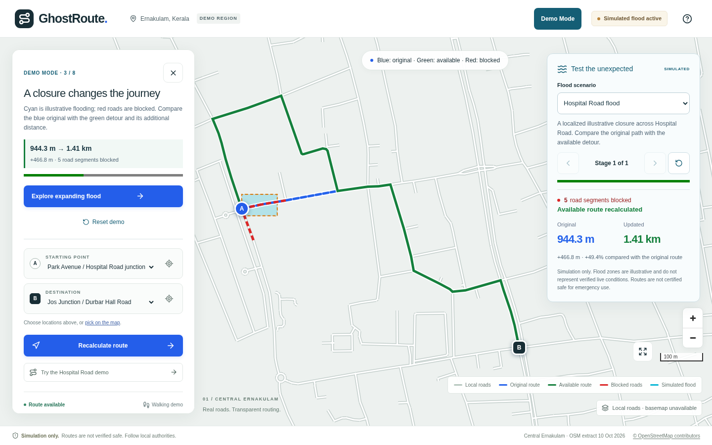
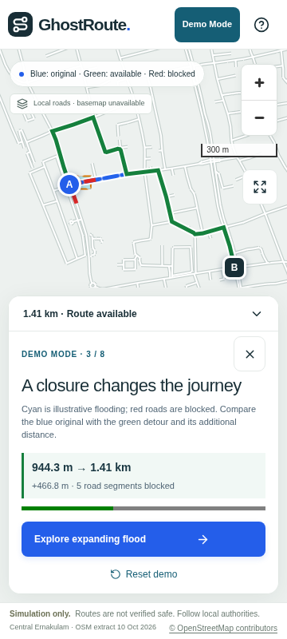
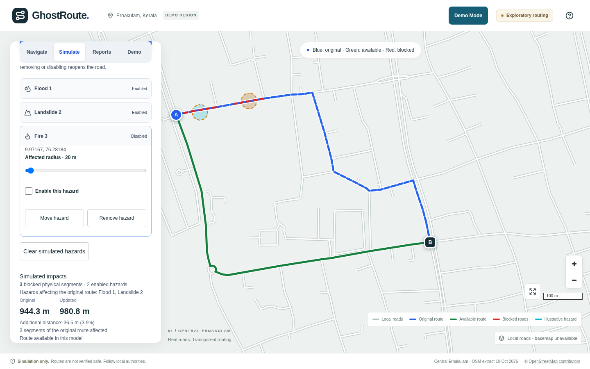

# DevDay Exchange Community Hackathon: Kochi

A repository template for participants at the 10–11 October 2026 hackathon. It contains event rules and documentation scaffolding; build your project from scratch at the event.

**[Event and registration on Luma](https://luma.com/z10nz8gp)** · **[Event rules](RULES.md)** · **[Agent instructions](AGENTS.md)**

## Event details

| Detail        | Information                                                     |
| ------------- | --------------------------------------------------------------- |
| Venue         | JAIN University, Kochi                                          |
| Location      | [Open the venue map](https://maps.app.goo.gl/Eme7gR7NDXSNRANu5) |
| Rooms         | 2008 and 2009                                                   |
| Check-in      | 10 October 2026, 6:00 PM IST                                    |
| Kick-off      | 10 October 2026, 6:30 PM IST                                    |
| Wrap-up       | 11 October 2026, by 10:00 AM IST                                |
| Participation | Solo or a team of up to 4 participants                          |
| Theme         | Open — build anything you like                                  |

Keep your approved Luma QR code ready for entry, and bring your laptop and charger. Eligible checked-in participants will receive Codex credits and OpenAI API credits.

## Use this template

1. Select **Use this template → Create a new repository** on GitHub. Create your own project repository and clone it.
2. Read [RULES.md](RULES.md) and [AGENTS.md](AGENTS.md) before building. Begin project implementation at the event.
3. Fill in the project overview below as you build. Use any suitable language or framework, keeping the implementation simple.
4. Record meaningful changes in [CHANGELOG.md](CHANGELOG.md) and your Codex usage in [AI_USAGE.md](AI_USAGE.md). Commit after completed milestones; aim for a meaningful checkpoint about every 30 minutes.
5. Complete [SUBMISSION.md](SUBMISSION.md) with your code repository, short project description, and working demo. Follow submission instructions announced by the organizers.

This template has no application code or required technology stack. The documentation and commit cadence are repository workflow guidance; the event participation rules are in [RULES.md](RULES.md).

## GhostRoute

Current version: four workspaces for arbitrary routing, editable multi-disaster simulation, browser-local unverified reports and the guided demo. See [platform workflows and limits](docs/PLATFORM.md).

**Navigate to safety when ordinary routes become unsafe.**

GhostRoute is an open-source disaster-aware navigation **simulation** for Kochi–Ernakulam. It demonstrates how a shortest path through real mapped roads changes when a simulated flood makes road segments unavailable.

**Current status: the complete local flood-routing demo and guided Demo Mode are implemented.** Explore real Ernakulam roads, calculate a route, start one of three illustrative flood scenarios, and compare automatic rerouting with the historical baseline. Deterministic expanding stages and explicit unavailable-route feedback work with local datasets, including when remote map tiles fail. Floods are simulated; destinations and emergency safety are unverified.

- **Project name:** GhostRoute
- **Team:** Participant names/handles await the team's confirmation; maximum four members.
- **Working demo:** `pnpm dev` opens the interactive route explorer. The implemented guided walkthrough is in [DEMO_PLAN](docs/DEMO_PLAN.md).
- **Technology stack:** Next.js App Router, React, strict TypeScript, Tailwind, pnpm, ESLint, Prettier, Vitest and Playwright. MapLibre GL JS and Lucide render the map and icons. Native accessible controls suffice for this screen; Turf and shadcn components remain deferred until needed.

### Problem and solution

A conventional shortest route is not evidence that roads remain usable during a disaster. GhostRoute will intersect simulated flood polygons with a real road graph, exclude blocked edges and recompute a shortest available path. This makes the reason for a route change visible and testable.

### Planned features and scope

P0: interactive Ernakulam map, origin and demo destination selection, real road graph, shortest path, fixed flood polygon, road blocking, automatic rerouting, original/updated route layers, unreachable handling, responsive controls and persistent simulation disclaimer. P1 adds richer comparisons, animation, replay, extra scenarios and access-aware routing if time remains. P2 explores verified feeds, community reports, real shelters and full offline use. See [PRD](docs/PRD.md).

### Architecture

A client dashboard renders local road GeoJSON with MapLibre; framework-independent TypeScript modules validate data, run Dijkstra and derive flood blockages. React owns selection/scenario state. Versioned OSM-derived assets are loaded locally; there is no backend, login, database or runtime Overpass request. Read [ARCHITECTURE](docs/ARCHITECTURE.md), [ADRs](docs/adr/README.md) and [DATA_STRATEGY](docs/DATA_STRATEGY.md).

### Run the project

Use Node.js 22.13+ in the Node 22 line, or Node 24 and the exact pnpm version in `package.json` (`11.25.0`). `.nvmrc` selects Node 22. Install pnpm through your preferred supported method, for example `npm install --global pnpm@11.25.0` if you manage this Node installation yourself.

```bash
git clone git@github.com:UmarAlMukhtar/GhostRoute.git
cd GhostRoute
pnpm install --frozen-lockfile
pnpm exec playwright install chromium
pnpm dev
```

In the original Codex workspace, run `cd repository` first; the official clone is nested beneath the initial empty Git shell. Open [localhost:3000](http://localhost:3000). No environment variables or API keys are required; `.env.example` records that explicitly. On supported Linux CI hosts, `pnpm exec playwright install --with-deps chromium` installs browser system libraries too. Fedora users may need equivalent native libraries; see [TESTING](docs/TESTING.md).

| Command                 | Purpose                                                        |
| ----------------------- | -------------------------------------------------------------- |
| `pnpm routes:benchmark` | Measure local initialization, routing, rerouting and snapping  |
| `pnpm data:prepare`     | Rebuild local road assets offline from the frozen OSM source   |
| `pnpm data:acquire`     | Intentionally refresh the OSM source; review before accepting  |
| `pnpm dev`              | Local Next development server                                  |
| `pnpm build`            | Production compilation                                         |
| `pnpm start`            | Serve an existing production build                             |
| `pnpm lint`             | ESLint                                                         |
| `pnpm typecheck`        | Generate Next route types, then strict TypeScript check        |
| `pnpm test`             | Vitest unit tests, non-watch mode                              |
| `pnpm test:e2e`         | Build and run Chromium browser tests against production server |
| `pnpm format`           | Format maintained files with Prettier                          |
| `pnpm format:check`     | Check formatting without edits                                 |

`RULES.md` is excluded from automatic formatting so its inherited bytes remain intact. Do not add npm/yarn lockfiles or competing tool configs. CI runs the same checks; local results are in [VERIFICATION](docs/VERIFICATION.md).

The local dataset has 1,719 nodes, 3,712 directed edges and 12 components. Run `pnpm data:prepare` to reproduce it without network access. [DATA_STRATEGY](docs/DATA_STRATEGY.md) records bounds, access assumptions and the verified alternate-path fixture. The [routing API](docs/ROUTING_ENGINE.md) supports node/edge/physical-road closures. Next: final UI/accessibility review, demo rehearsal, deployment verification and participant-owned submission. See [flood simulation](docs/FLOOD_SIMULATION.md).

### Demo instructions and limitations

1. Run `pnpm dev`, then open the app. Use **Try the Hospital Road demo**, then **Find route**: the actual shortest path is 944.3 m across 21 directed road segments.
2. Alternatively choose named locations from the two menus, or use their crosshair buttons to pick on the map. Clicked points snap within 100 m; the panel reports the offset and the map distinguishes the clicked hollow dot from the snapped letter marker.
3. Change either endpoint to clear the previous route, calculate again, or **Reset**. On mobile, expand/collapse the routing sheet with its header button. Presets work without map clicks.
4. If remote street tiles fail or take over 12 seconds, local roads and routing remain usable. WebGL failure leaves named route controls/results available, with a clear error. This is not a complete offline web app: app assets must be served locally or loaded beforehand.

`dev` and `build` copy the installed MapLibre worker and shared module into ignored, versioned local assets; no CDN worker is required. The optional OSM street tiles use normal browser caching, visible attribution and no prefetch. See the [OSMF tile policy](https://operations.osmfoundation.org/policies/tiles/) and [map architecture](docs/ARCHITECTURE.md#map-02-browser-integration). Automated browser tests abort external tile requests. No hosted deployment is claimed. The implemented guided walkthrough is in [DEMO_PLAN](docs/DEMO_PLAN.md).

**Simulation only. Hazards and destinations are demonstration data. Routes are not verified safe. Follow local authorities.** The graph is a small, potentially stale extract; the flood model is two-dimensional. Neither an unblocked road nor a synthetic destination establishes actual access, capacity or safety.

### Roadmap and contributing

Start with [CONTRIBUTOR_GUIDE](docs/CONTRIBUTOR_GUIDE.md), [CONTRIBUTING](CONTRIBUTING.md) and [AGENTS](AGENTS.md). Claim one local task from [TASKS](docs/TASKS.md), read its dependencies and relevant ADR, write the behavior test and keep the PR focused. [ROADMAP](docs/ROADMAP.md) gives the eight-hour critical path. Issues and labels in the task catalog are prepared locally, not created on GitHub.

### Sources and licensing

New GhostRoute code/documentation uses [MIT](LICENSE), with the inherited organizer text excluded from that grant pending license clarification. The [template audit](docs/TEMPLATE_AUDIT.md) records provenance. Bundled OSM source/derived assets use [ODbL](https://www.openstreetmap.org/copyright) and [bundled attribution](public/data/ernakulam/ATTRIBUTION.md). The code of conduct adapts [Contributor Covenant 2.1](https://www.contributor-covenant.org/version/2/1/code_of_conduct/) under its own license. Dependency versions are pinned in `package.json` and `pnpm-lock.yaml`.

See [AI_USAGE.md](AI_USAGE.md) for AI assistance, [CHANGELOG.md](CHANGELOG.md) for the development record and [SUBMISSION.md](SUBMISSION.md) for the organizer's submission checklist.

### Run the flood demonstration

1. Choose **Try the Hospital Road demo**, then **Find route**: 944.3 m.
2. **Start simulation**: 5 segments close; the real detour becomes 1.41 km (+49.4%).
3. Select **Expanding urban flood** and use **Next stage** twice: 27 segments close; the route becomes 1.73 km.
4. Select **Route unavailable**: 21 segments close around the destination; no alternative is drawn.
5. **Reset simulation** restores the baseline. **Reset** clears endpoints and simulation.

Flood conditions are illustrative, not verified live information. Routes are not certified safe for emergency use. All scenarios run locally; public street tiles are optional. Benchmark with `node --experimental-strip-types scripts/benchmark-simulation.ts`.

### Three-minute Demo Mode

Run `pnpm build` then `pnpm start` and choose **Demo Mode** in the header. Advance at your own pace: Ernakulam overview → real baseline → Hospital flood detour → expanding stages → unavailable destination → restored baseline. **Reset demo** returns to the overview in one click. Header **Demo Mode** also restarts the sequence. Manual routing and scenario controls remain available; using them exits the guided sequence while retaining the selected route/scenario. Refresh starts a clean session. Guide statistics use actual results, including on mobile.

[Presenter pitch](docs/PITCH_SCRIPT.md) · [Submission narrative](docs/HACKATHON_SUBMISSION.md) · [Vercel runbook](docs/DEPLOYMENT.md) · [Readiness priorities and stop conditions](docs/ROADMAP.md#final-readiness-priorities-and-explicit-stop-conditions)

### Screenshots from the real production browser run

Desktop and mobile captures below use the actual local graph/router with optional public map tiles deliberately blocked. They are screenshots of illustrative scenarios, not live flood observations.





### Deployment and submission status

Vercel configuration is prepared locally; no public URL or hosted build is claimed. No environment variables are required. Follow DEPLOYMENT.md only after approving the target account/project and publishing actions. The submitted implementation SHA, participant handles/contributions, two timed human rehearsals and venue submission confirmations remain human-owned. New code is MIT; OSM data is ODbL with separate attribution, and inherited organizer-text redistribution terms still need clarification.

### Interactive multi-disaster platform

Use **Navigate** to select arbitrary supported map points, enter coordinates, drag/swap endpoints or request your current location. **Simulate** adds editable flood, landslide and fire exclusion zones or individual roadblocks; multiple hazards automatically update real shortest paths. **Reports** saves unverified observations locally, with separate purple markers and filters. **Demo** retains the guided Hospital Road scenarios.

Reports persist **in this browser only**, not across users and not with emergency services. They do not affect routes by default. Incident-aware mode has no trusted verification feed; explicitly opting into exploratory unverified closures uses associated roads only. Simulations and reports remain separate; clearing hazards preserves reports. No new credentials are required for this local version. Shared Supabase persistence, verified moderation, photo uploads and address search are not implemented.

See [platform workflows, policies and cloud migration](docs/PLATFORM.md), [current verification](docs/VERIFICATION.md) and [ADR-010](docs/adr/010-interactive-hazards-reports.md). Simulation radii are illustrative, not scientific hazard models. No calculated route is certified safe.



[Mobile platform screenshot](docs/screenshots/platform-mobile.png) · [Local incident report screenshot](docs/screenshots/reports-desktop.png)

### Offline place search and demo coverage

**Starting point** and **Destination** now search a verified local catalog. Focus an empty field for seven popular Ernakulam places; type a name, locality or category, then use arrow keys/Enter or click/tap a result. Routes update automatically. Clear either field, swap endpoints, or use map selection/coordinates as before. **Demo endpoint shortcuts** retains the original fixture selectors.

A dashed teal boundary marks the road dataset's geographic extent. **View Demo Area** fits that region; roads inside may be disconnected or unmapped. Search only offers reviewed points that can connect to the other endpoint, without silently relocating them to a farther node. Search works offline; it is not a general address geocoder. Snapping within 100 m is an approximation, not a verified accessible entrance.

[Place sources, licensing and maintenance](data/places/README.md) · Validate with `pnpm places:verify`. Existing simulation and local incident-reporting workflows are unchanged.

[Desktop coverage and route](docs/screenshots/coverage-desktop.png) · [Mobile search](docs/screenshots/search-mobile.png)
