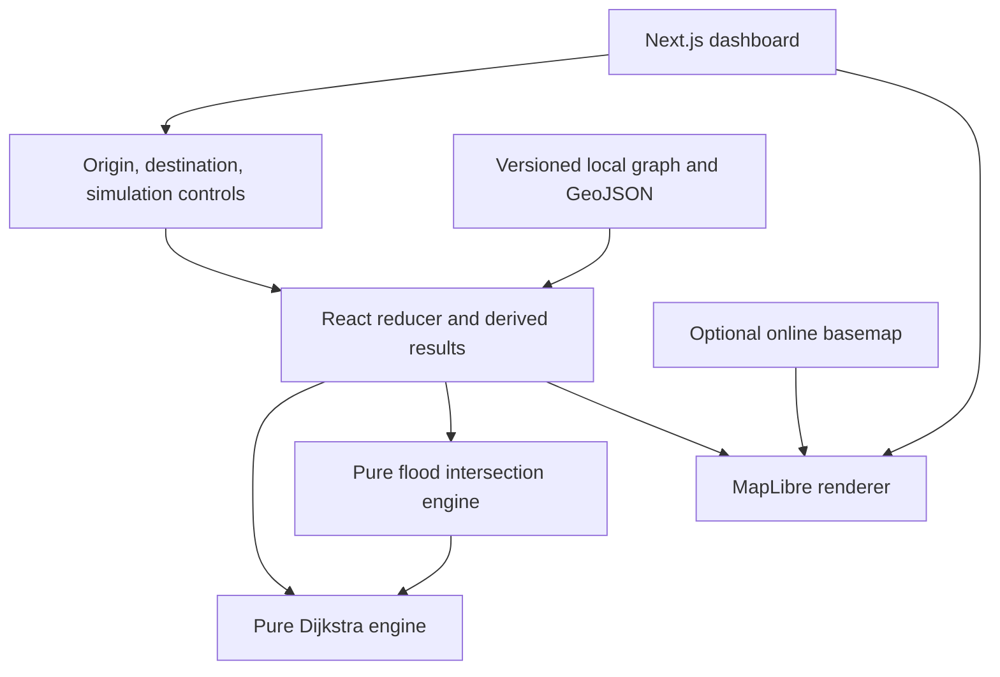
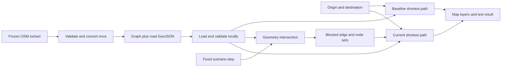
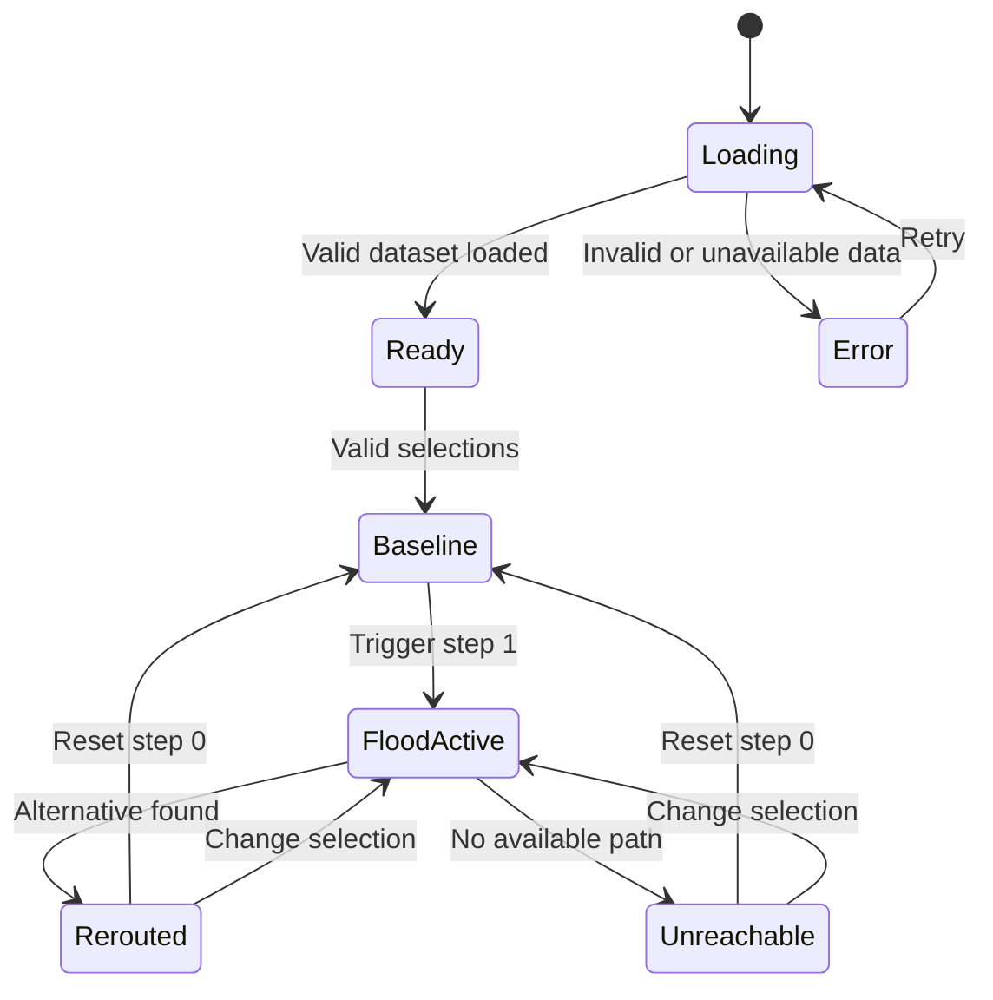
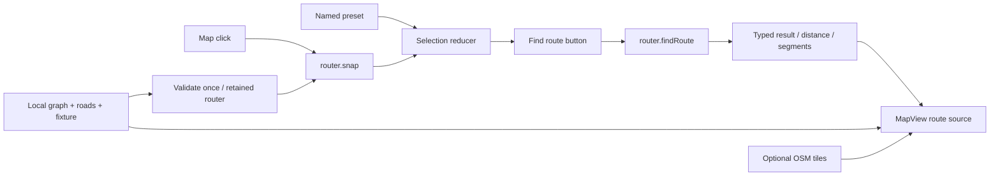

# GhostRoute architecture

## Expanded platform — current architecture

`Dashboard` reuses the retained router and flood engine for `/` and `/demo`. The left panel remains navigation; an independent right panel contains custom simulation or local reports. Guided scenarios require the `/demo` composition. Internal routing modes are absent from controls. Unverified reports do not close roads.

`loadMapData` caches validated graph, road geometry, fixtures and the separate static `places.json` index. Index failure leaves map/coordinate navigation usable with a visible search error. Large immutable assets are loaded once, not copied into per-feature React state. `validatePlaces` checks directed anchor reachability using two traversals, not thousands of shortest paths. A 0.002-degree node grid narrows snapping candidates; exact geodesic checks and full-scan failure fallback preserve the snapping contract. Local results debounce 180 ms and cancel stale timers; selection revalidates coverage/connectivity.

Walking-v2 combines untagged degree-two shape nodes outside the original regression envelope, preserving full LineStrings, source node identities at junctions, tagged nodes, access barriers and directionality. Toll booths are recognized as non-physical barriers; explicit foot/general access remains enforced. Unknown gates remain excluded. The Hospital Road segment IDs and geometry remain unchanged.

`ThemeToggle` uses a persisted preference and system media subscription. A pre-render script applies the root theme before content paints; hydration suppression is confined to the root attribute. MapLibre paint properties change in place. Dark mode uses the local vector-road style and hides optional light raster tiles; no map color inversion. Browser-local storage is editable, so deletion is archive management, not server authorization.

Status: accepted implementation direction for the small MVP; module paths below are planned unless explicitly listed as present. Phase 0 supplies `src/app/` smoke UI/tooling; MAP-01 now implements `src/lib/geo/`, source acquisition/conversion and local road assets. ROUTE-01 implements heap-based routing and closure-aware node snapping. MAP-02 implements the interactive client dashboard and MapLibre rendering. Read [PRD](PRD.md), [data strategy](DATA_STRATEGY.md) and [ADRs](adr/README.md) together.

## System and application structure

Next.js App Router supplies the page/build pipeline. A client-only dashboard owns React state and a client-only MapLibre instance. Pure TypeScript functions handle graph validation, routing and flood intersections. Static local geographic assets and browser-local incident storage are the runtime data sources. No shared incident service is connected. No API routes, authentication, database, server actions or routing service.

| Planned path                             | Responsibility                                                                       |
| ---------------------------------------- | ------------------------------------------------------------------------------------ |
| `src/app/` (present)                     | Layout, page, styles; dashboard composition and global styles                        |
| `src/components/MapView.tsx`             | Map instance, layer/source updates, cleanup and map load/error states                |
| `src/components/SimulationPanel.tsx`     | Trigger/reset and visible simulation state                                           |
| `src/components/Dashboard.tsx` (present) | Local asset boundary, selections, actual route results and accessible feedback       |
| `src/components/ui/`                     | Only shadcn components actually needed; use native controls first when adequate      |
| `src/lib/geo/types.ts`                   | Contracts below; one authoritative shared module                                     |
| `src/lib/geo/validate.ts`                | Validate untrusted JSON before exposing a RoadGraph                                  |
| `src/lib/routing/shortest-path.ts`       | Dijkstra, no React/MapLibre imports                                                  |
| `src/lib/simulation/flood.ts`            | Polygon validation/intersection and blocked edge derivation                          |
| `src/lib/simulation/session.ts`          | Scenario reducer and route comparison; selection reducer remains in map/selection.ts |
| `scripts/prepare-roads.ts`               | Implemented deterministic offline conversion                                         |
| `data/source/`                           | Compressed normalized OSM source, request URL and manifest (present)                 |
| `public/data/ernakulam/`                 | Graph, GeoJSON, metadata and path fixture (present); scenarios/destinations later    |
| `tests/unit/`, `tests/e2e/` (present)    | Foundation tests now; behavioral suites added with their features                    |

Map rendering uses separate sources for roads, baseline, current route, blocked segments, flood polygon and destinations. Initialize after mount and clean up on unmount; use `setData`, not repeated map creation. Background tiles are optional; use a local style with background and road layers when offline. Never make routing depend on tile load success. Handle WebGL failure with textual error and route controls/results where possible. Include visible OSM attribution on the local-road fallback too.

## Shared TypeScript contracts

The authoritative contracts now live in [`src/lib/geo/types.ts`](../src/lib/geo/types.ts): `GeoPoint` is a named `[longitude, latitude]` tuple; RoadNode, RoadEdge, RoadGraph, DisasterZone, FloodScenario, EmergencyShelter, RouteRequest, RouteResult and RoutingProfile match the planned MVP. `RoadGeoJSON` adds typed physical-segment features with source tags and directed edge IDs. GeoJSON types come from `@types/geojson`; no React or map renderer dependency enters these contracts.

`validateGraph`, haversine distance, OSM conversion, dataset validation and validation-only BFS/component reporting are implemented. `geo/connectivity.findPath` remains a MAP-01 connectivity witness; `routing/shortest-path.createRouter` implements production shortest-distance routing. Roads are locally available at `/data/ernakulam/graph.json` and `/data/ernakulam/roads.geojson`; source and runtime manifests carry hashes and provenance. Import/parse JSON as unknown then validate; MAP-02 loads these assets once per browser session.

Function contracts: `validateGraph(input: unknown): RoadGraph` throws a descriptive validation error at the loading boundary; `shortestPath(graph: RoadGraph, request: RouteRequest): RouteResult`; `deriveBlockages(graph: RoadGraph, zones: DisasterZone[]): { blockedEdgeIds: Set<string>; blockedNodeIds: Set<string> }`. Inputs are immutable. At load time reject a scenario whose `graphVersion` differs from the graph, invalid step indices, and shelter references to missing nodes. A zero-edge successful route has one node, 0 m and null line geometry. Failed results never contain a route polyline. Unknown endpoints, endpoint closures, no route, malformed options and snapping failures have distinct typed statuses described in [ROUTING_ENGINE](ROUTING_ENGINE.md); data parsing failures become a dataset error state.

## Ingestion, representation and connectivity

Convert frozen OSM node/way JSON using node identities, not coordinate proximity. Initially split every eligible way at consecutive OSM nodes; each allowed direction becomes an edge with its full segment geometry and geodesic length in meters. This is simple and preserves intersection identities. Build adjacency once, including empty arrays for isolated nodes. Keep separate grade crossings separate unless an OSM node is actually shared. Reject missing nodes, duplicate IDs, invalid coordinates and nonpositive/nonfinite weights. Record excluded ways and components; do not silently patch gaps. Walking-only access/direction rules and boundary buffer are defined in [DATA_STRATEGY](DATA_STRATEGY.md).

## Routing algorithm

Dijkstra minimizes positive meter weights using an indexed binary min-heap with decrease-key, O((V + E) log V). This replaces the earlier linear-scan plan per the explicit ROUTE-01 requirement ([ADR-008](adr/008-heap-routing.md)). Queue ties use code-unit node IDs; sorted outgoing edge IDs and strict improvement preserve the first equal-cost predecessor. Stop only when the destination is settled. Requests support blocked nodes, directed edges and physical segments without changing the graph.

Use `createRouter(validateGraph(input))` once per dataset version, then `router.findRoute(request)` for repeated changes and `router.snap(coordinate, options)` for selections. The router takes a private snapshot, indexes incoming/outgoing edges and the original largest weak component, and validates positive weights/endpoints. Untrusted JSON still goes through the full geographic validator first. The exported `shortestPath(graph, request)` is a one-off convenience. Results include ordered physical segments, copied endpoints/geometry and deterministic metadata; no ETA or safety score. Snapping uses haversine meters and directional eligibility under the same closures; it does not establish physical access or path reachability. See [ROUTING_ENGINE](ROUTING_ENGINE.md) for contracts, statuses, examples and limits.

## Simulation engine and spatial logic

SIM-01 provides three deterministic scenarios: localized Hospital Road, three nested urban extents, and a flooded destination; all include clear stage 0. No random numbers, physical depth model or wall-clock updates. Use Turf `booleanIntersects` on an entire road LineString and the flood Polygon, so endpoints, crossings, boundary contact and a line contained in the polygon are covered. A line entirely within a polygon hole remains unblocked unless it touches a boundary. Index segment bounds once and memoize the current scenario/stage result; block every directed edge with that segment ID. Use boundary-inclusive point-in-polygon for nodes, including destinations. Reject invalid rings/self-intersections before execution. Ignore elevation deliberately: this is conservative 2D simulation, not hydrology.

## State and dynamic recalculation

Retain MAP-02’s selection reducer and add a simulation reducer for `scenarioId`, `stage`, `enabled`. This avoids restructuring working endpoint interactions; routes are derived from both at render time. Keep dataset loading/error separate. Derive blocked sets and baseline/current routes from these inputs with memoization; do not maintain duplicate mutable route state. Computation is synchronous for the bounded MVP, avoiding stale async responses. Selection changes derive both routes; step changes reuse the baseline. Trigger is disabled until data and selections are valid; reset sets step 0. The baseline remains visible as historical comparison while the current result is pending/unreachable, never as a recommended route.

`FloodActive` is a logical transition; no fake progress timer is needed. A baseline may itself be unreachable. Display that explicitly before allowing the presenter to select a reachable preset.

## Errors, performance and tests

Show separate states for loading, invalid dataset, selection outside snapping radius, graph disconnected, endpoint flooded, tiles unavailable and WebGL unavailable. A failed load must not fall back silently to synthetic roads. Log concise diagnostics without personal locations. Loading local JSON happens once; rebuild adjacency only when dataset version changes. Measure budgets from PRD; no worker, spatial tree or state library until evidence requires it. Unit tests cover the pure modules, integration tests the reducer/recalculation, and Playwright the journey. Tests use local data and a tile-free style. See [TESTING](TESTING.md).

## Future backend extensibility

Static manifests can later be replaced by validated, versioned data fetches at the existing loading boundary. Verified closure feeds need timestamp/expiry, provenance and human review; shelter status needs agency ownership. Multi-user reports need authentication and abuse controls. Keep these out of the MVP rather than adding unused service interfaces today.

## MAP-02 browser integration

- `components/Dashboard.tsx` owns the data-loading boundary, selection reducer, accessible controls and route results. It calls the retained `router.findRoute` directly; there is no routing logic in React. `lib/map/selection.ts` handles state transitions, calls `router.snap` and maps typed results to feedback. Changing an endpoint clears old route geometry; invalid clicks preserve the previous selection and report the failure. Reset clears both endpoints/result.
- `lib/map/data.ts` fetches local graph, roads and demo fixtures concurrently. It validates the graph once, checks every road feature against validated graph geometry/IDs and verifies preset version/coordinates. The shared promise survives Strict Mode remounts and retries after rejection. Bounds derive from the validated nodes. No runtime Overpass call occurs.
- `components/MapView.tsx` dynamically imports MapLibre after mount, renders GeoJSON sources, updates data without rebuilding the map and cleans up workers/listeners/markers/observers on unmount. `lib/map/style.ts` supplies the tile-independent style. Origin/destination are two DOM markers, not thousands of React road elements. Route geometry is the real returned LineString; zero-distance routes have a marker and no line.
- `MapOverlays` now receives Polygon/MultiPolygon hazards, blocked-road lines and alternative-route lines. SIM-01 supplies validated geometry and closures; INT-01 derives baseline/current routes using the retained router. Sources update without rebuilding the map. See [FLOOD_SIMULATION](FLOOD_SIMULATION.md) for contracts, scenarios and limitations.
- The map first loads local roads, then optional OSM raster tiles. A tile error or 12-second loading timeout removes the raster source and reports local-road mode. Non-tile errors and WebGL context loss are visible; route controls remain usable. Attribution/disclaimer live outside the canvas and sheets.
- MapLibre 6's module worker cannot use its package-relative URL inside the Next bundle. `scripts/prepare-maplibre.mjs` copies the exact installed worker/shared module and BSD license into `public/vendor/maplibre/<version>/`; `dev`/`build` run it automatically. `setWorkerUrl` selects that same-origin URL. Generated files are ignored. No external worker/CDN dependency.
- [OSM tile policy](https://operations.osmfoundation.org/policies/tiles/) reviewed for this demonstration: standard browser Referer/cache behavior, visible attribution, no bulk downloads, no tile archives, no automated public-tile traffic. Availability is best effort. [MapLibre raster source documentation](https://maplibre.org/maplibre-gl-js/docs/examples/add-a-raster-tile-source/) informs the source/layer setup.

SIM-01/INT-01 are implemented in `simulation/flood.ts`, `scenarios.ts`, `session.ts`, Dashboard and SimulationPanel. Pure calculations remain independent of React and MapLibre. Invalid flood results suppress alternatives and display a reason.

## Presenter guide and deployment boundary

`lib/map/demo.ts` contains eight ordered cues and existing scenario/stage identifiers, never stored route metrics. `DemoGuide` renders progress and actual baseline/current values. Dashboard batches the existing selection and simulation reducer actions for each presenter step; it retains the same validated graph, flood engine and router. Manual actions exit the guide, preventing narration/state divergence. A one-click restart clears selections/closures and requests a regional camera fit without reconstructing MapLibre. The guide has no timers or additional state library.

`vercel.json` pins install/build commands and uses the standard Next.js framework output. Worker assets are generated before every build. Environment variables are unnecessary. Remote publication is separate from this locally verified configuration; see DEPLOYMENT.md.

## Interactive multi-disaster extension

`simulation/hazards.ts` defines explicitly simulated, editable zones and geodesic circle construction. The existing `createFloodEngine` validates and intersects flood/landslide/fire polygons and direct physical-segment closures; Dijkstra is unchanged. `incidents/reports.ts` separately validates/persists browser-local observations and supplies the explicit exploratory policy. `ExploreControls` presents editors and reports, `Dashboard` composes state/derived results, and `MapView` adds draggable endpoints and a separate purple report source. There is no cloud backend or runtime Overpass dependency. Baseline recalculates whenever both endpoints change; closures are selected by routing mode. The initialized graph/router are reused. See [ADR-010](adr/010-interactive-hazards-reports.md) and [PLATFORM](PLATFORM.md).

## Verified offline place search and coverage

`data/places/ernakulam.json` is a small bundled gazetteer; source evidence and ODbL terms are in [its README](../data/places/README.md). `lib/map/places.ts` validates it once against the retained `MapData` router and graph version. `PlaceSearch` filters locally, exposes an accessible combobox/listbox and rechecks nearest-node snapping and directed connectivity before dispatching the existing selection action. Typing/clearing removes the old endpoint and route; swapping updates both labels; Reset clears drafts too. Map clicks, coordinates, geolocation and demo endpoint shortcuts retain the same selection service. Existing memoized route/simulation derivation automatically recalculates both distances. No second router or geocoding backend is introduced.

`coverageGeometry(data.bounds)` creates the dataset extent Polygon and LineString. MapLibre keeps these sources/layers throughout route and hazard updates. The translucent fill sits below roads/hazards and the dashed outline below routes/blocked roads. A small geographic label and legend explain the extent; View Demo Area fits the same validated bounds without changing route/simulation state. A selected place requests a camera focus only for a single endpoint; once both exist, the route fit takes precedence. See [ADR-011](adr/011-local-place-search.md).
