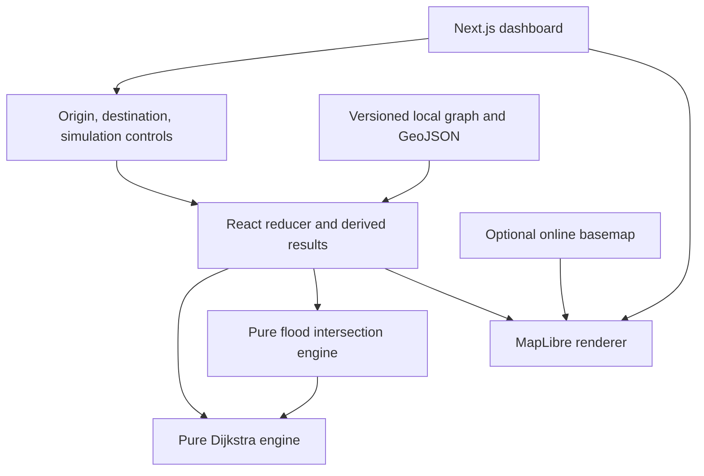
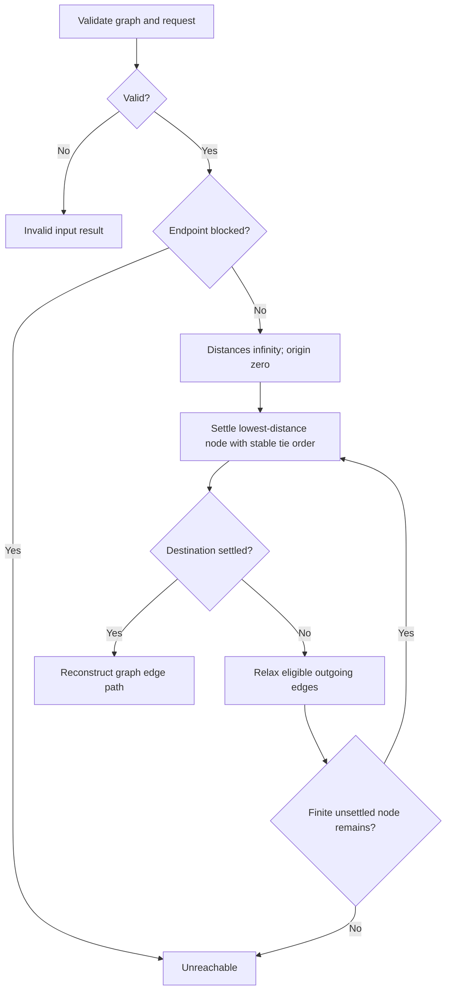
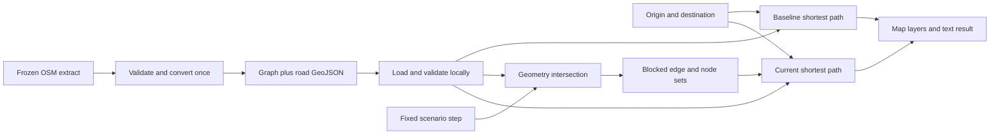
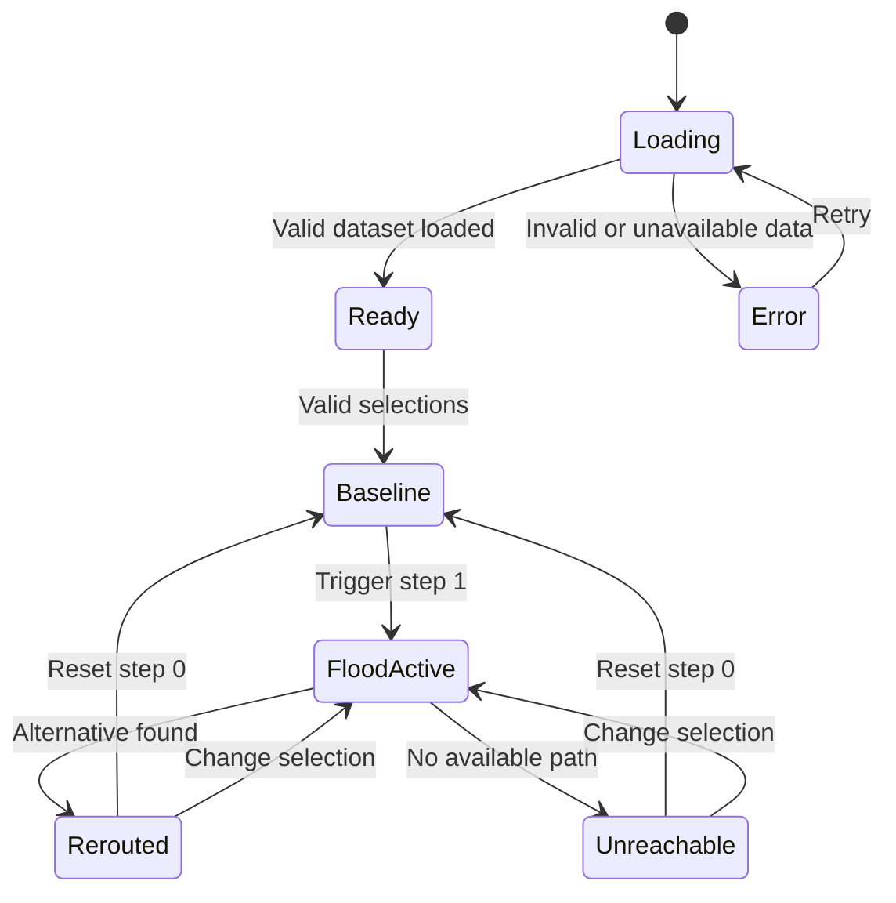

# GhostRoute architecture

Status: accepted implementation direction for the small MVP; module paths below are planned unless explicitly listed as present. Phase 0 supplies `src/app/` smoke UI/tooling; MAP-01 now implements `src/lib/geo/`, source acquisition/conversion and local road assets. Read [PRD](PRD.md), [data strategy](DATA_STRATEGY.md) and [ADRs](adr/README.md) together.

## System and application structure

Next.js App Router supplies the page/build pipeline. A client-only dashboard owns React state and a client-only MapLibre instance. Pure TypeScript functions handle graph validation, routing and flood intersections. Static local assets are the only runtime data dependency. No API routes, authentication, database, server actions or routing service.

| Planned path                          | Responsibility                                                                    |
| ------------------------------------- | --------------------------------------------------------------------------------- |
| `src/app/` (present)                  | Layout, page, styles; currently static tooling smoke page                         |
| `src/components/MapView.tsx`          | Map instance, layer/source updates, cleanup and map load/error states             |
| `src/components/SimulationPanel.tsx`  | Trigger/reset and visible simulation state                                        |
| `src/components/RoutePanel.tsx`       | Selections, distances, baseline/current status and accessible feedback            |
| `src/components/ui/`                  | Only shadcn components actually needed; use native controls first when adequate   |
| `src/lib/geo/types.ts`                | Contracts below; one authoritative shared module                                  |
| `src/lib/geo/validate.ts`             | Validate untrusted JSON before exposing a RoadGraph                               |
| `src/lib/routing/shortest-path.ts`    | Dijkstra, no React/MapLibre imports                                               |
| `src/lib/simulation/flood.ts`         | Polygon validation/intersection and blocked edge derivation                       |
| `src/lib/simulation/state.ts`         | Reducer for selections and scenario step; no geometry duplicated in state         |
| `scripts/prepare-roads.ts`            | Implemented deterministic offline conversion                                      |
| `data/source/`                        | Compressed normalized OSM source, request URL and manifest (present)              |
| `public/data/ernakulam/`              | Graph, GeoJSON, metadata and path fixture (present); scenarios/destinations later |
| `tests/unit/`, `tests/e2e/` (present) | Foundation tests now; behavioral suites added with their features                 |

Map rendering uses separate sources for roads, baseline, current route, blocked segments, flood polygon and destinations. Initialize after mount and clean up on unmount; use `setData`, not repeated map creation. Background tiles are optional; use a local style with background and road layers when offline. Never make routing depend on tile load success. Handle WebGL failure with textual error and route controls/results where possible. Include visible OSM attribution on the local-road fallback too.

## Shared TypeScript contracts

The authoritative contracts now live in [`src/lib/geo/types.ts`](../src/lib/geo/types.ts): `GeoPoint` is a named `[longitude, latitude]` tuple; RoadNode, RoadEdge, RoadGraph, DisasterZone, FloodScenario, EmergencyShelter, RouteRequest, RouteResult and RoutingProfile match the planned MVP. `RoadGeoJSON` adds typed physical-segment features with source tags and directed edge IDs. GeoJSON types come from `@types/geojson`; no React or map renderer dependency enters these contracts.

`validateGraph`, haversine distance, OSM conversion, dataset validation and validation-only BFS/component reporting are implemented. `findPath` is a connectivity witness, **not** the production shortest-distance engine. Roads are locally available at `/data/ernakulam/graph.json` and `/data/ernakulam/roads.geojson`; source and runtime manifests carry hashes and provenance. Import/parse JSON as unknown then validate; UI loading is MAP-02.

Function contracts: `validateGraph(input: unknown): RoadGraph` throws a descriptive validation error at the loading boundary; `shortestPath(graph: RoadGraph, request: RouteRequest): RouteResult`; `deriveBlockages(graph: RoadGraph, zones: DisasterZone[]): { blockedEdgeIds: Set<string>; blockedNodeIds: Set<string> }`. Inputs are immutable. At load time reject a scenario whose `graphVersion` differs from the graph, invalid step indices, and shelter references to missing nodes. A zero-edge successful route has one node, 0 m and null line geometry. Failed results never contain a route polyline. Unknown request node/edge IDs or unsupported profile produce `invalid`; data parsing failures become a dataset error state.

## Ingestion, representation and connectivity

Convert frozen OSM node/way JSON using node identities, not coordinate proximity. Initially split every eligible way at consecutive OSM nodes; each allowed direction becomes an edge with its full segment geometry and geodesic length in meters. This is simple and preserves intersection identities. Build adjacency once, including empty arrays for isolated nodes. Keep separate grade crossings separate unless an OSM node is actually shared. Reject missing nodes, duplicate IDs, invalid coordinates and nonpositive/nonfinite weights. Record excluded ways and components; do not silently patch gaps. Walking-only access/direction rules and boundary buffer are defined in [DATA_STRATEGY](DATA_STRATEGY.md).

## Routing algorithm

Dijkstra minimizes sum of positive meter weights. For this bounded graph, start with an array/set of unsettled node IDs and a linear minimum scan: O(V² + E), simple to verify. Sort node IDs and outgoing edge IDs; on equal cost keep the first discovered predecessor. Stop after settling the destination. Reject invalid requests before traversal; skip blocked edges and blocked nodes, never mutate base weights or the base graph. Reconstruct both edge IDs and node IDs and join edge geometries. If measured p95 exceeds 100 ms, reduce the extent first; adopt a small binary heap only after profiling (ADR-003). Do not display fabricated ETA.

## Simulation engine and spatial logic

P0 has two deterministic steps: clear and one fixed flood polygon. No random numbers, physical depth model or wall-clock updates. Use Turf `booleanIntersects` on an entire road LineString and the flood Polygon, so endpoints, crossings, boundary contact and a line contained in the polygon are covered. A line entirely within a polygon hole remains unblocked unless it touches a boundary. Cache results per physical segment for the current step; block every directed edge with that segment ID. Use boundary-inclusive point-in-polygon for nodes, including destinations. Reject invalid rings/self-intersections before execution. Ignore elevation deliberately: this is conservative 2D simulation, not hydrology.

## State and dynamic recalculation

Use a single page-level reducer for `originNodeId`, `shelterId`, `scenarioId`, `step`. Keep dataset loading/error separate. Derive blocked sets and baseline/current routes from these inputs with memoization; do not maintain duplicate mutable route state. Computation is synchronous for the bounded MVP, avoiding stale async responses. Selection changes derive both routes; step changes reuse the baseline. Trigger is disabled until data and selections are valid; reset sets step 0. The baseline remains visible as historical comparison while the current result is pending/unreachable, never as a recommended route.

`FloodActive` is a logical transition; no fake progress timer is needed. A baseline may itself be unreachable. Display that explicitly before allowing the presenter to select a reachable preset.

## Errors, performance and tests

Show separate states for loading, invalid dataset, selection outside snapping radius, graph disconnected, endpoint flooded, tiles unavailable and WebGL unavailable. A failed load must not fall back silently to synthetic roads. Log concise diagnostics without personal locations. Loading local JSON happens once; rebuild adjacency only when dataset version changes. Measure budgets from PRD; no worker, spatial tree or state library until evidence requires it. Unit tests cover the pure modules, integration tests the reducer/recalculation, and Playwright the journey. Tests use local data and a tile-free style. See [TESTING](TESTING.md).

## Future backend extensibility

Static manifests can later be replaced by validated, versioned data fetches at the existing loading boundary. Verified closure feeds need timestamp/expiry, provenance and human review; shelter status needs agency ownership. Multi-user reports need authentication and abuse controls. Keep these out of the MVP rather than adding unused service interfaces today.
